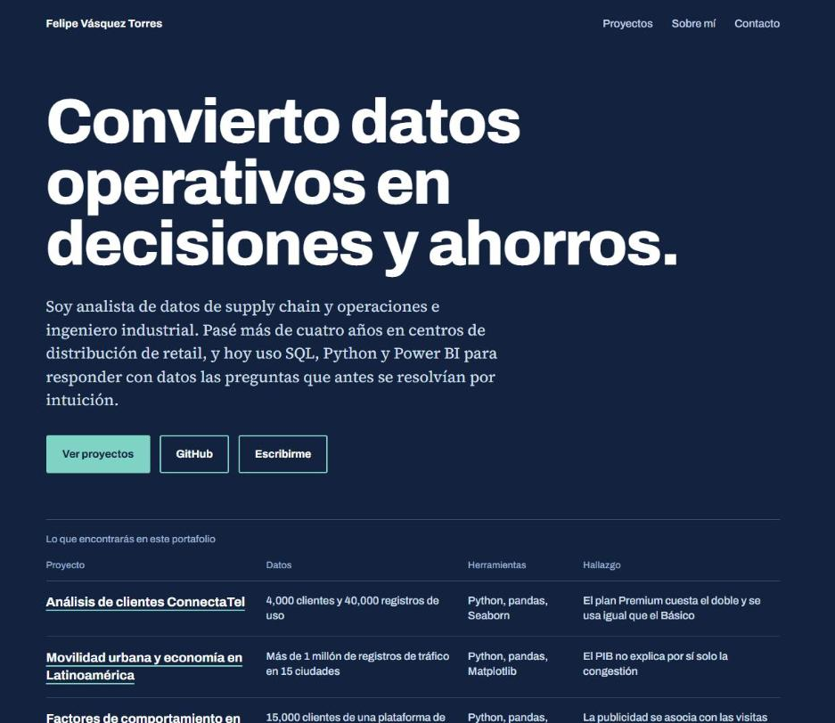

# Portafolio de análisis de datos · Felipe Vásquez Torres

### [Ver el portafolio: fvt1999pipe-eng.github.io](https://fvt1999pipe-eng.github.io)

Analista de datos de supply chain y operaciones. En el portafolio cada proyecto se cuenta con el problema, lo que hice, el resultado y lo que aprendí.

## Proyectos

| Proyecto | Herramientas | Código |
|---|---|---|
| Capacidad de almacenamiento para la temporada alta | Python, SQL, Excel | [capacidad_cedis_temporada](https://github.com/fvt1999pipe-eng/capacidad_cedis_temporada) |
| Diagnóstico integral de RappiPlus | SQL, Python, statsmodels, Power BI | [analisis_rappiplus](https://github.com/fvt1999pipe-eng/analisis_rappiplus) |
| Dashboard comercial inmobiliario para Andes Capital | Power BI, DAX | [dashboard_andes_capital](https://github.com/fvt1999pipe-eng/dashboard_andes_capital) |
| Dashboard de desempeño comercial para Andes Retail | Power BI, Power Query | [dashboard_andes_retail](https://github.com/fvt1999pipe-eng/dashboard_andes_retail) |
| Experimento A/B en una página de inicio | Python, SciPy, statsmodels | [analisis_experimento_ab](https://github.com/fvt1999pipe-eng/analisis_experimento_ab) |
| Factores de comportamiento e ingreso en NovaRetail+ | Python, pandas, SciPy | [analisis_novaretail](https://github.com/fvt1999pipe-eng/analisis_novaretail) |
| Movilidad urbana y economía en Latinoamérica | Python, pandas | [ladb_mobility_economy_project](https://github.com/fvt1999pipe-eng/ladb_mobility_economy_project) |
| Análisis de clientes ConnectaTel | Python, pandas | [analisis_connectaTel](https://github.com/fvt1999pipe-eng/analisis_connectaTel) |

## Cómo está hecho

Construido con HTML y CSS, publicado con GitHub Pages. Todo el sitio está en [`index.html`](index.html).

**Contacto:** [LinkedIn](https://www.linkedin.com/in/felipe-vasquez-torres) · fe.vasqueztorres@gmail.com
